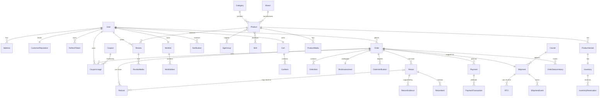

# KiddyBD Database Design & Schema Specification

This document provides a comprehensive database design based on the KiddyBD Production Architecture Specification, including refinements and fixes.

## 1. Global Enums

```prisma
enum Role {
  SUPER_ADMIN
  ADMIN
  ORDER_MANAGER
  INVENTORY_MANAGER
  CUSTOMER_SUPPORT
  CONTENT_MANAGER
  FINANCE_MANAGER
  CUSTOMER
}

enum UserStatus {
  ACTIVE
  SUSPENDED
  BLOCKED
  DELETED
}

enum AddressValidationStatus {
  VALID
  NEEDS_REVIEW
  INCOMPLETE
}

enum ProductStatus {
  DRAFT
  ACTIVE
  OUT_OF_STOCK
  ARCHIVED
}

enum MediaType {
  IMAGE
  VIDEO
}

enum OrderStatus {
  PENDING
  RISK_REVIEW
  VERIFICATION_REQUIRED
  CONFIRMED
  PROCESSING
  SHIPPED
  OUT_FOR_DELIVERY
  DELIVERED
  CANCELLED
  RTO
}

enum OrderVerificationType {
  OTP
  SMS_LINK
  MANUAL_CALL
  ADVANCE_PAYMENT
}

enum OrderVerificationStatus {
  PENDING
  VERIFIED
  FAILED
  EXPIRED
}

enum RiskLevel {
  LOW
  MEDIUM
  HIGH
}

enum PaymentStatus {
  PENDING
  PROCESSING
  COMPLETED
  FAILED
  REFUNDED
}

enum ShipmentStatus {
  PENDING
  PICKED_UP
  IN_TRANSIT
  REACHED_LOCAL_HUB
  OUT_FOR_DELIVERY
  DELIVERED
  RETURNED
}

enum RTOReason {
  CUSTOMER_UNAVAILABLE
  WRONG_ADDRESS
  PHONE_UNREACHABLE
  CUSTOMER_REFUSED
  CUSTOMER_CANCELLED
  COURIER_ISSUE
  OTHER
}

enum ReturnStatus {
  REQUESTED
  UNDER_REVIEW
  APPROVED
  REJECTED
  PICKUP_SCHEDULED
  RECEIVED
  QUALITY_CHECK
  COMPLETED
  CANCELLED
}

enum ReturnReason {
  WRONG_PRODUCT
  DAMAGED
  DEFECTIVE
  NOT_AS_EXPECTED
  MISSING_PARTS
  SIZE_ISSUE
  CHANGE_OF_MIND
  OTHER
}

enum RefundStatus {
  PENDING
  PROCESSING
  COMPLETED
  FAILED
}

enum ReviewStatus {
  PENDING
  APPROVED
  REJECTED
}

enum CouponType {
  PERCENTAGE
  FIXED
  FREE_DELIVERY
}
```

## 2. Entities & Fields

### Core User & Customer Modules
**User**
*   `id` (UUID, PK)
*   `phone` (String, Nullable, Unique)   // Nullable — user may register via Email or Google only
*   `email` (String, Nullable, Unique)
*   `googleId` (String, Nullable, Unique) // Google OAuth subject ID (`sub` field)
*   `name` (String)
*   `passwordHash` (String, Nullable)    // Only set for admin users (email+password login)
*   `role` (Enum: Role)
*   `status` (Enum: UserStatus)
*   `phoneVerifiedAt` (DateTime, Nullable)
*   `emailVerifiedAt` (DateTime, Nullable)
*   `googleLinkedAt` (DateTime, Nullable)
*   `createdAt`, `updatedAt`

> **Constraint:** At least one of `phone`, `email`, or `googleId` MUST be non-null.
> `CHECK (phone IS NOT NULL OR email IS NOT NULL OR googleId IS NOT NULL)`

**RefreshToken**
*   `id` (UUID, PK)
*   `userId` (UUID, FK)
*   `tokenHash` (String)
*   `expiresAt` (DateTime)
*   `revokedAt` (DateTime, Nullable)
*   `replacedByTokenId` (UUID, Nullable)
*   `createdAt`
*   `ip` (String)
*   `userAgent` (String)

**CustomerReputation**
*   `id` (UUID, PK)
*   `userId` (UUID, FK, Unique)
*   `totalOrders` (Int)
*   `completedOrders` (Int)
*   `cancelledOrders` (Int)
*   `rtoOrders` (Int)
*   `returnedOrders` (Int)
*   `totalSpent` (Decimal)
*   `deliverySuccessRate` (Decimal)
*   `rtoRate` (Decimal)
*   `cancelRate` (Decimal)
*   `returnRate` (Decimal)
*   `lastOrderAt` (DateTime, Nullable)

**Address**
*   `id` (UUID, PK)
*   `userId` (UUID, FK)
*   `name` (String)
*   `phone` (String)
*   `division` (String)
*   `district` (String)
*   `upazila` (String)
*   `area` (String)
*   `addressLine` (String)
*   `landmark` (String, Nullable)
*   `postalCode` (String, Nullable)
*   `latitude` (Decimal, Nullable)
*   `longitude` (Decimal, Nullable)
*   `isDefault` (Boolean)
*   `validationStatus` (Enum: AddressValidationStatus)
*   `createdAt`, `updatedAt`

### Product & Intelligence Modules
**Category**
*   `id` (UUID, PK)
*   `name` (String)
*   `slug` (String, Unique)
*   `parentId` (UUID, FK, Nullable)

**Brand**
*   `id` (UUID, PK)
*   `name` (String)
*   `slug` (String, Unique)

**AgeGroup**
*   `id` (UUID, PK)
*   `rangeLabel` (String) // e.g., "3-5"

**Skill**
*   `id` (UUID, PK)
*   `name` (String) // e.g., "Fine Motor Skills"

**Product**
*   `id` (UUID, PK)
*   `name` (String)
*   `slug` (String, Unique)
*   `description` (Text)
*   `shortDescription` (Text)
*   `categoryId` (UUID, FK)
*   `brandId` (UUID, FK, Nullable)
*   `status` (Enum: ProductStatus)
*   `material` (String)
*   `origin` (String)
*   // Safety fields
*   `recommendedAge` (String)
*   `smallPartsWarning` (Boolean)
*   `chokingHazard` (Boolean)
*   `supervisionRequired` (Boolean)
*   `materialSafety` (Text, Nullable)
*   `safetyInstructions` (Text, Nullable)
*   `createdAt`, `updatedAt`

**ProductVariant**
*   `id` (UUID, PK)
*   `productId` (UUID, FK)
*   `sku` (String, Unique)
*   `title` (String) // e.g., "Red / 20 Pieces"
*   `price` (Decimal)
*   `discountPrice` (Decimal, Nullable)
*   `weight` (Decimal)
*   `dimensions` (String, Nullable)
*   `isActive` (Boolean, @default(true))
*   `createdAt`, `updatedAt`

**ProductMedia**
*   `id` (UUID, PK)
*   `productId` (UUID, FK)
*   `type` (Enum: MediaType)
*   `url` (String)
*   `altText` (String, Nullable)
*   `sortOrder` (Int)
*   `isPrimary` (Boolean)

*(Join Tables for M:N)*
*   **ProductAgeGroup** (`productId`, `ageGroupId`)
*   **ProductSkill** (`productId`, `skillId`)

### Inventory Module
**Inventory**
*   `variantId` (UUID, PK, FK to ProductVariant)
*   `quantity` (Int)
*   `reservedQuantity` (Int) // Managed via constraints & locks
*   `lowStockThreshold` (Int)
*   `updatedAt`

**InventoryReservation**
*   `id` (UUID, PK)
*   `variantId` (UUID, FK)
*   `orderId` (UUID, FK, Nullable)
*   `quantity` (Int)
*   `status` (Enum: ACTIVE, RELEASED, COMMITTED, EXPIRED)
*   `expiresAt` (DateTime)
*   `createdAt`, `releasedAt` (DateTime, Nullable)

### Cart & Order Modules
**Cart**
*   `id` (UUID, PK)
*   `userId` (UUID, FK, Unique)
*   `updatedAt`

**CartItem**
*   `id` (UUID, PK)
*   `cartId` (UUID, FK)
*   `productId` (UUID, FK)
*   `variantId` (UUID, FK)
*   `quantity` (Int)
*   `createdAt`, `updatedAt`

**Order**
*   `id` (UUID, PK)
*   `orderNumber` (String, Unique)
*   `customerId` (UUID, FK)
*   `status` (Enum: OrderStatus)
*   `paymentStatus` (Enum: PaymentStatus)
*   `fulfillmentStatus` (String, Nullable) // UNFULFILLED, PARTIALLY_FULFILLED, FULFILLED
*   `couponId` (UUID, FK, Nullable)
*   `subtotal` (Decimal)
*   `discount` (Decimal)
*   `deliveryCharge` (Decimal)
*   `total` (Decimal)
*   `codAmount` (Decimal)
*   `shippingAddressSnapshot` (JSONB)
*   `billingAddressSnapshot` (JSONB)
*   `createdAt`, `updatedAt`

**OrderItem**
*   `id` (UUID, PK)
*   `orderId` (UUID, FK)
*   `productId` (UUID, FK)
*   `variantId` (UUID, FK)
*   `productNameSnapshot` (String)
*   `variantTitleSnapshot` (String)
*   `skuSnapshot` (String)
*   `unitPrice` (Decimal)
*   `quantity` (Int)
*   `returnedQuantity` (Int) @default(0) // Tracks partial returns
*   `discount` (Decimal)
*   `subtotal` (Decimal)

**OrderStatusHistory**
*   `id` (UUID, PK)
*   `orderId` (UUID, FK)
*   `fromStatus` (Enum: OrderStatus, Nullable)
*   `toStatus` (Enum: OrderStatus)
*   `reason` (String, Nullable)
*   `changedBy` (UUID, FK, Nullable)
*   `createdAt`

### Risk & Verification
**RiskAssessment**
*   `id` (UUID, PK)
*   `orderId` (UUID, FK, Unique)
*   `score` (Int)
*   `level` (Enum: RiskLevel)
*   `signals` (JSONB)
*   `reasons` (JSONB)
*   `action` (String)
*   `createdAt`

**OrderVerification**
*   `id` (UUID, PK)
*   `orderId` (UUID, FK)
*   `type` (Enum: OrderVerificationType)
*   `status` (Enum: OrderVerificationStatus)
*   `attempts` (Int)
*   `expiresAt` (DateTime)
*   `verifiedAt` (DateTime, Nullable)
*   `createdAt`

### Payment Module
**Payment**
*   `id` (UUID, PK)
*   `orderId` (UUID, FK)
*   `provider` (String)
*   `status` (Enum: PaymentStatus)
*   `amount` (Decimal)
*   `createdAt`, `updatedAt`

**PaymentTransaction**
*   `id` (UUID, PK)
*   `paymentId` (UUID, FK)
*   `provider` (String)
*   `externalTransactionId` (String, Nullable)
*   `amount` (Decimal)
*   `status` (Enum: PaymentStatus)
*   `rawReference` (JSONB, Nullable)
*   `createdAt`, `updatedAt`

**PaymentWebhookEvent**
*   `id` (UUID, PK)
*   `provider` (String)
*   `externalEventId` (String)
*   `eventType` (String)
*   `payload` (JSONB)
*   `signature` (String)
*   `processed` (Boolean)
*   `processedAt` (DateTime, Nullable)
*   `createdAt`

### Courier, Shipment & RTO
**Courier**
*   `id` (UUID, PK)
*   `name` (String)
*   `code` (String, Unique)
*   `status` (String)
*   `apiBaseUrl` (String, Nullable)
*   `config` (JSONB, Nullable)
*   `createdAt`, `updatedAt`

**Shipment**
*   `id` (UUID, PK)
*   `orderId` (UUID, FK, Unique)
*   `courierId` (UUID, FK)
*   `trackingId` (String, Unique)
*   `status` (Enum: ShipmentStatus)
*   `weight` (Decimal)
*   `codAmount` (Decimal)
*   `shippingCost` (Decimal)
*   `shippedAt`, `deliveredAt`, `returnedAt` (DateTime, Nullable)
*   `createdAt`, `updatedAt`

**ShipmentEvent**
*   `id` (UUID, PK)
*   `shipmentId` (UUID, FK)
*   `status` (Enum: ShipmentStatus)
*   `externalStatus` (String)
*   `location` (String, Nullable)
*   `description` (String, Nullable)
*   `occurredAt` (DateTime)
*   `createdAt`

**RTO**
*   `id` (UUID, PK)
*   `orderId` (UUID, FK)
*   `shipmentId` (UUID, FK)
*   `reason` (Enum: RTOReason)
*   `notes` (Text, Nullable)
*   `createdAt`

### Returns & Refunds
**Return**
*   `id` (UUID, PK)
*   `orderId` (UUID, FK)
*   `customerId` (UUID, FK)
*   `reason` (Enum: ReturnReason)
*   `description` (Text, Nullable)
*   `status` (Enum: ReturnStatus)
*   `requestedAt`, `approvedAt`, `receivedAt` (DateTime, Nullable)
*   `createdAt`, `updatedAt`

**ReturnItem**
*   `id` (UUID, PK)
*   `returnId` (UUID, FK)
*   `orderItemId` (UUID, FK)
*   `quantity` (Int)
*   `reason` (Enum: ReturnReason)

**ReturnEvidence**
*   `id` (UUID, PK)
*   `returnId` (UUID, FK)
*   `type` (Enum: MediaType)
*   `url` (String)
*   `createdAt`

**Refund**
*   `id` (UUID, PK)
*   `returnId` (UUID, FK, Nullable) // Nullable if refunding pre-shipment cancellation
*   `orderId` (UUID, FK)
*   `amount` (Decimal)
*   `method` (String)
*   `status` (Enum: RefundStatus)
*   `reason` (String, Nullable)
*   `transactionId` (String, Nullable)
*   `processedAt` (DateTime, Nullable)
*   `createdAt`

### Coupons, Promotions, Reviews, Wishlist & System
**Coupon**
*   `id` (UUID, PK)
*   `code` (String, Unique)
*   `type` (Enum: CouponType)
*   `value` (Decimal)
*   `minimumOrderAmount` (Decimal, Nullable)
*   `maximumDiscount` (Decimal, Nullable)
*   `usageLimit` (Int, Nullable)
*   `perUserLimit` (Int, Nullable)
*   `isActive` (Boolean, @default(true))
*   `startDate`, `endDate` (DateTime)
*   `createdAt`, `updatedAt`

**CouponUsage**
*   `id` (UUID, PK)
*   `couponId` (UUID, FK)
*   `userId` (UUID, FK)
*   `orderId` (UUID, FK)
*   `discountAmount` (Decimal)
*   `createdAt`

**CouponProduct** *(Join Table for Coupon → Product restrictions)*
*   `couponId` (UUID, FK)
*   `productId` (UUID, FK)
*   `@@id([couponId, productId])`

**CouponCategory** *(Join Table for Coupon → Category restrictions)*
*   `couponId` (UUID, FK)
*   `categoryId` (UUID, FK)
*   `@@id([couponId, categoryId])`

**Review**
*   `id` (UUID, PK)
*   `productId` (UUID, FK)
*   `customerId` (UUID, FK)
*   `orderId` (UUID, FK)
*   `rating` (Int)
*   `title` (String, Nullable)
*   `comment` (Text)
*   `verifiedPurchase` (Boolean)
*   `status` (Enum: ReviewStatus)
*   `createdAt`, `updatedAt`

**ReviewMedia**
*   `id` (UUID, PK)
*   `reviewId` (UUID, FK)
*   `type` (Enum: MediaType)
*   `url` (String)
*   `createdAt`

**AuditLog**
*   `id` (UUID, PK)
*   `userId` (UUID, FK)
*   `action` (String)
*   `entity` (String)
*   `entityId` (String)
*   `oldValue` (JSONB, Nullable)
*   `newValue` (JSONB, Nullable)
*   `ip` (String)
*   `userAgent` (String)
*   `createdAt`

**IdempotencyKey**
*   `id` (UUID, PK)
*   `key` (String, Unique)
*   `userId` (UUID, FK, Nullable)
*   `endpoint` (String)
*   `requestHash` (String)
*   `responseStatus` (Int, Nullable)
*   `responseBody` (JSONB, Nullable)
*   `expiresAt` (DateTime)
*   `createdAt`

### Wishlist Module
**Wishlist**
*   `id` (UUID, PK)
*   `userId` (UUID, FK, Unique)
*   `createdAt`, `updatedAt`

**WishlistItem**
*   `id` (UUID, PK)
*   `wishlistId` (UUID, FK)
*   `productId` (UUID, FK)
*   `addedAt` (DateTime)
*   `@@unique([wishlistId, productId])`

### Notification Module
**Notification**
*   `id` (UUID, PK)
*   `userId` (UUID, FK)
*   `channel` (String) // SMS, EMAIL, PUSH
*   `type` (String) // ORDER_CREATED, OTP, SHIPPED, etc.
*   `title` (String)
*   `body` (Text)
*   `metadata` (JSONB, Nullable)
*   `sentAt` (DateTime, Nullable)
*   `readAt` (DateTime, Nullable)
*   `status` (String) // PENDING, SENT, FAILED, READ
*   `createdAt`

### Promotion Module
**Promotion**
*   `id` (UUID, PK)
*   `name` (String)
*   `slug` (String, Unique)
*   `description` (Text, Nullable)
*   `type` (String) // BANNER, FLASH_SALE, FEATURED, etc.
*   `startDate` (DateTime)
*   `endDate` (DateTime)
*   `isActive` (Boolean, @default(true))
*   `metadata` (JSONB, Nullable) // Banner image, link, config etc.
*   `priority` (Int, @default(0))
*   `createdAt`, `updatedAt`

**CODConfig** *(Singleton table — admin-configurable COD & risk rules)*
*   `id` (UUID, PK)
*   `minimumOrderAmount` (Decimal, @default(0))
*   `maximumCODAmount` (Decimal)
*   `riskThresholdLow` (Int, @default(29))   // 0 – threshold = LOW
*   `riskThresholdMedium` (Int, @default(69)) // +1 – threshold = MEDIUM; above = HIGH
*   `advancePaymentPercentage` (Decimal, @default(20)) // % advance required for HIGH risk
*   `codVerificationRequired` (Boolean, @default(true))
*   `updatedBy` (UUID, FK, Nullable)
*   `updatedAt`

## 3. Critical Indexes & Constraints

### Constraints
*   **Foreign Keys**: Standard strict foreign key constraints across all relationships to maintain referential integrity.
*   **User Auth Constraint**: `CHECK (phone IS NOT NULL OR email IS NOT NULL OR googleId IS NOT NULL)` — at least one identifier required.
*   **Inventory Check**: `CHECK (quantity >= 0 AND reservedQuantity >= 0 AND reservedQuantity <= quantity)`
*   **Return Check**: `CHECK (returnedQuantity >= 0)` on `OrderItem`.
*   **Review Limit**: `@@unique([customerId, productId, orderId])`
*   **Cart Limit**: A User can only have one active Cart (Unique Constraint on `Cart.userId`).
*   **Coupon Limit**: `@@unique([couponId, orderId])`
*   **Wishlist Limit**: `@@unique([wishlistId, productId])` on `WishlistItem`.

### Performance Indexes (B-Tree)
*   `User`: `phone`, `email`, `googleId`
*   `Product`: `slug`, `categoryId`, `status`
*   `ProductVariant`: `sku`, `productId`
*   `Order`: `orderNumber`, `customerId`, `status`, `createdAt`
*   `OrderItem`: `orderId`, `productId`, `variantId`
*   `Payment`: `orderId`
*   `PaymentTransaction`: `paymentId`, `externalTransactionId`
*   `Shipment`: `trackingId`, `orderId`, `courierId`
*   `RiskAssessment`: `orderId`
*   `Return`: `orderId`, `customerId`
*   `IdempotencyKey`: `key`, `userId`
*   `Wishlist`: `userId`
*   `WishlistItem`: `wishlistId`, `productId`
*   `Notification`: `userId`, `type`, `status`
*   `Promotion`: `slug`, `isActive`, `startDate`, `endDate`
*   `Review`: `productId`, `customerId`
*   `PaymentWebhookEvent`: `externalEventId`, `provider`
*   `CouponUsage`: `couponId`, `userId`, `orderId`

### JSONB Indexes (GIN)
*   `Order.shippingAddressSnapshot`
*   `Order.billingAddressSnapshot`
*   `RiskAssessment.signals`

## 4. Transaction Boundaries

Database transactions MUST be used for the following operations to ensure ACID compliance:

1.  **Order Creation (`BEGIN ... COMMIT`)**
    *   Validate Product/Coupon/Stock
    *   `INSERT Order`
    *   `INSERT OrderItem` (multiple)
    *   `UPDATE Inventory` (increment `reservedQuantity`)
    *   `INSERT InventoryReservation`
    *   `INSERT RiskAssessment`
    *   *Rollback immediately if stock check or insertion fails.*

2.  **Order Cancellation / Expiration**
    *   `UPDATE Order` (status = CANCELLED)
    *   `UPDATE InventoryReservation` (status = EXPIRED/RELEASED)
    *   `UPDATE Inventory` (decrement `reservedQuantity`)
    *   `INSERT OrderStatusHistory`
    *   *Trigger Refunds via background job if Payment was completed.*

3.  **Payment Fulfillment**
    *   `UPDATE PaymentTransaction`
    *   `UPDATE Payment`
    *   `UPDATE Order` (status = CONFIRMED)
    *   `UPDATE InventoryReservation` (status = COMMITTED)

4.  **Return & Refund Processing**
    *   `UPDATE Return` (status = APPROVED/COMPLETED)
    *   `UPDATE OrderItem` (increment `returnedQuantity`)
    *   `INSERT Refund` (status = PENDING)
    *   *Trigger Payment Gateway API for Refund via Job.*

## 5. Entity Relationship Diagram (ERD)


